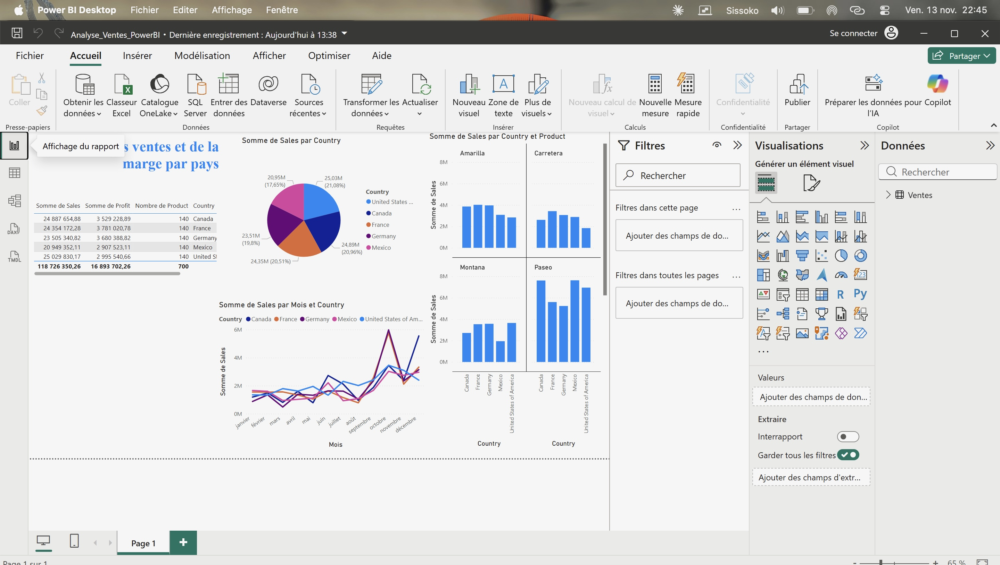

# Analyse des ventes et du profit par pays (Power BI)

Rapport Power BI d'analyse des ventes et du profit par pays (Canada, France,
Allemagne, Mexique, États-Unis), avec évolution mensuelle, ventes par produit
et filtres interactifs.

Jeu de données : Financial Sample (Microsoft), 700 lignes.

## Questions posées
- Quels pays réalisent le plus de chiffre d'affaires et de profit ?
- Comment les ventes évoluent-elles au fil des mois ?
- Quels produits se vendent le mieux dans chaque pays ?

## Contenu du rapport
- Tableau récapitulatif : ventes, profit et nombre de produits par pays
- Répartition des ventes par pays
- Évolution mensuelle des ventes par pays
- Ventes par produit et par pays
- Filtre interactif par pays

## Principaux constats
- Chiffre d'affaires total : environ 118,7 M ; profit total : environ 16,9 M,
  soit une marge d'environ 14 %.
- Les États-Unis ont le chiffre d'affaires le plus élevé (environ 25,0 M) mais
  le profit le plus faible rapporté aux ventes (environ 12 %).
- L'activité est plus forte en fin d'année.

## Fichiers
- `Analyse_Ventes_PowerBI.pbix` : le rapport Power BI Desktop

## Outils
Power BI Desktop
